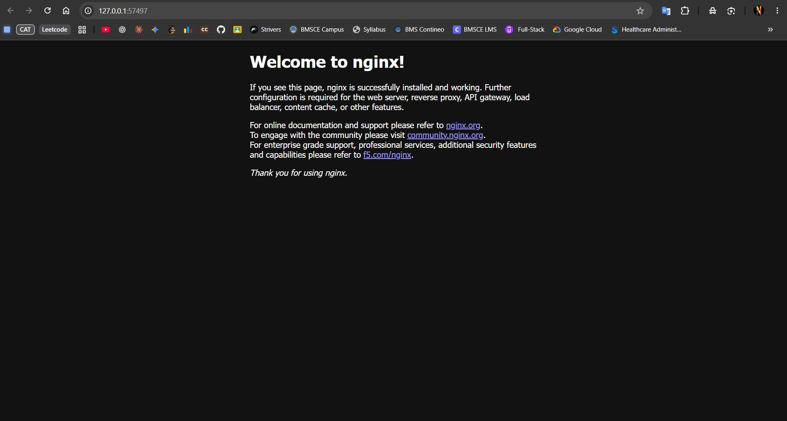

# Exercise 1: Hello Pod

## Problem Statement

As a DevOps Engineer at Zepto, deploy the product team's lightweight web app (storefront and delivery status page) on Kubernetes so that it is always running, portable, and can be scaled later. The app is simulated using the `nginx` container image.

**Goal:** Run the first app inside Kubernetes as a Pod, expose it as a Service, and access it in the browser.

**Environment:** Windows 11 Home Single Language, VS Code integrated terminal (Command Prompt), Docker Desktop, Minikube

---

## Solution (Brief)

1. Start a local single-node Kubernetes cluster using Minikube with the Docker driver.
2. Create a Pod named `hello-k8s` running the `nginx` image on port 80.
3. Verify that the Pod is in the `Running` state.
4. Expose the Pod as a `NodePort` Service so it is reachable from outside the cluster.
5. Open the Service in the browser using Minikube and confirm the Nginx welcome page loads.

---

## Commands Executed

### Step 1: Start the Minikube cluster

On Windows Home, use the Docker driver rather than Hyper-V:

```cmd
minikube start --driver=docker
```

### Step 2: Create the Pod using the Nginx image

```cmd
kubectl run hello-k8s --image=nginx --port=80
```

### Step 3: Verify the Pod is running

```cmd
kubectl get pods
```

Wait until the `STATUS` column shows `Running`. If it shows `ContainerCreating`, run `kubectl get pods` again after a short wait.

### Step 4: Expose the Pod as a Service

```cmd
kubectl expose pod hello-k8s --type=NodePort --port=80
```

### Step 5: Open the app in the browser

```cmd
minikube service hello-k8s
```

Minikube should open the Service URL in the default browser. Alternatively, print the URL with:

```cmd
minikube service hello-k8s --url
```

If Minikube prints a localhost URL, keep the terminal running while testing it, as the Docker driver on Windows may require a tunnel to stay active.

---

## Output / Proof

Nginx welcome page opened in the browser after running `minikube service hello-k8s`:



The screenshot above shows the Nginx welcome page successfully loaded through the Minikube Service.

---

## Result

The `hello-k8s` Pod runs the Nginx image inside the Minikube cluster, is exposed through a NodePort Service, and the Nginx welcome page can be accessed in the browser.

## Optional Verification

Check the Service and cluster resources:

```cmd
kubectl get services
kubectl get pods -o wide
minikube status
```

## Cleanup (Optional)

Delete the Service and Pod when the exercise is complete:

```cmd
kubectl delete service hello-k8s
kubectl delete pod hello-k8s
```
