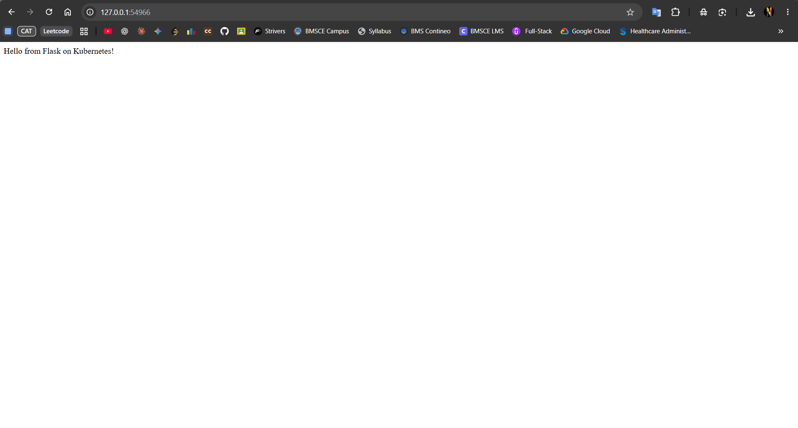

# Exercise 2: Deploy a Flask App on Minikube Using kubectl and YAML

## Problem Statement

As a DevOps engineer, deploy a lightweight Python Flask application to a local Kubernetes cluster using Minikube. Package the application in a Docker image, define the Kubernetes Deployment and Service using YAML, verify that the Pod is running, and access the application from a browser.

**Goal:** Build and deploy a Flask app that returns `Hello from Flask on Kubernetes!`, expose it through a Kubernetes Service, and verify that it is accessible.

**Environment:** Windows 11 Home Single Language, VS Code integrated terminal, Docker Desktop, Minikube with the Docker driver.

---

## Solution (Brief)

1. Start the local Minikube cluster using Docker.
2. Create a Flask application that listens on port `15000`.
3. Build a Docker image and load it into Minikube.
4. Create a Kubernetes Deployment and NodePort Service in `flask-deployment.yaml`.
5. Apply the YAML file and verify the Deployment, Pod, and Service.
6. Open the Service URL and confirm the Flask response appears in the browser.

---

## Commands Executed

### Step 1: Start Minikube

```cmd
minikube start --driver=docker
```

Verify the cluster:

```cmd
minikube status
kubectl get nodes
```

### Step 2: Create the Flask application

Create `app.py`:

```python
from flask import Flask

app = Flask(__name__)

@app.route('/')
def home():
    return "Hello from Flask on Kubernetes!"

if __name__ == '__main__':
    app.run(host='0.0.0.0', port=15000)
```

### Step 3: Create the Dockerfile

Create a file named `Dockerfile` (without a file extension):

```dockerfile
FROM python:3.12-slim

WORKDIR /app

RUN pip install --no-cache-dir flask

COPY app.py .

EXPOSE 15000

CMD ["python", "app.py"]
```

### Step 4: Build and load the Docker image

Run these commands from the project directory containing `app.py` and `Dockerfile`:

```cmd
docker build -t flask-app:latest .
minikube image load flask-app:latest
```

### Step 5: Create the Kubernetes YAML file

Create `flask-deployment.yaml`:

```yaml
apiVersion: apps/v1
kind: Deployment
metadata:
  name: flask-app
spec:
  replicas: 1
  selector:
    matchLabels:
      app: flask-app
  template:
    metadata:
      labels:
        app: flask-app
    spec:
      containers:
        - name: flask-app
          image: flask-app:latest
          imagePullPolicy: Never
          ports:
            - containerPort: 15000
---
apiVersion: v1
kind: Service
metadata:
  name: flask-app-service
spec:
  type: NodePort
  selector:
    app: flask-app
  ports:
    - port: 15000
      targetPort: 15000
```

### Step 6: Deploy the application

```cmd
kubectl apply -f flask-deployment.yaml
```

### Step 7: Verify the Deployment and Pod

```cmd
kubectl get deployments
kubectl get pods -l app=flask-app
kubectl get services
```

Wait until the Deployment shows `1/1` available and the Pod status is `Running` with `1/1` ready.

### Step 8: Describe the Deployment and check logs

```cmd
kubectl describe deployment flask-app
kubectl logs deployment/flask-app
```

The logs should indicate that Flask is listening on port `15000`.

### Step 9: Access the Flask application

```cmd
minikube service flask-app-service --url
```

Open the URL printed by Minikube in the browser. If Minikube says the terminal must remain open, keep that terminal running while accessing the URL.

Expected response:

```text
Hello from Flask on Kubernetes!
```

---

## Output / Proof

The Flask application was accessed successfully in the browser through the Minikube Service URL.



---

## Result

The Flask application was packaged into a Docker image, deployed to the Minikube Kubernetes cluster through a YAML-defined Deployment, and exposed using a NodePort Service. The browser displayed `Hello from Flask on Kubernetes!`, confirming that the application was accessible.

---

## Key Concepts Learned

- **Docker image:** Packages the Flask application and its runtime dependencies.
- **Deployment:** Manages the desired number of application Pods.
- **Pod:** Runs the Flask container inside Kubernetes.
- **Service:** Provides a stable way to reach the application.
- **`port` vs `targetPort`:** `port` is the Service port; `targetPort` is the port the application listens on inside the Pod.
- **`imagePullPolicy: Never`:** Requires the image to already be available on the Kubernetes node.

## Troubleshooting Commands

```cmd
kubectl get pods
kubectl describe pod -l app=flask-app
kubectl logs deployment/flask-app
kubectl get services
minikube status
```

If the application code changes, rebuild and reload the image, then restart the Deployment:

```cmd
docker build -t flask-app:latest .
minikube image load flask-app:latest
kubectl rollout restart deployment/flask-app
kubectl rollout status deployment/flask-app
```
