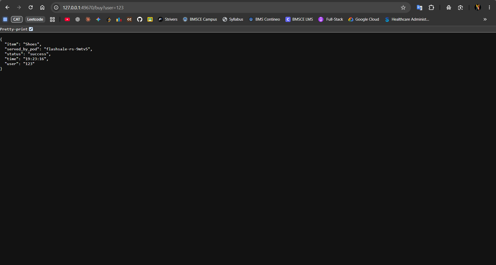
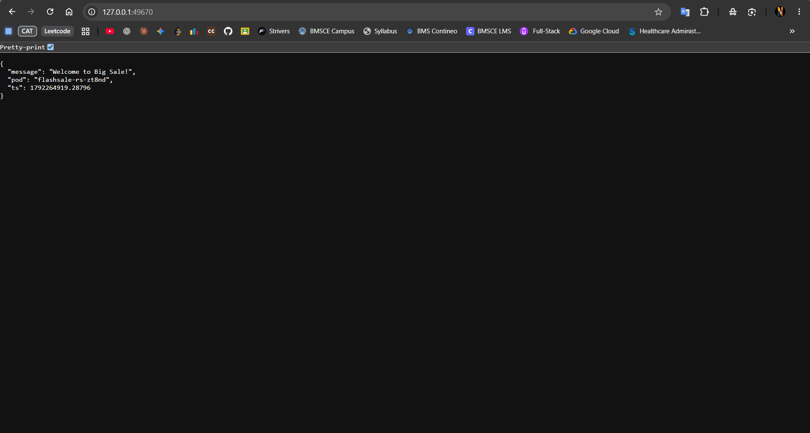

# Exercise 3: Scaling a Flask App on a Single Node Using ReplicaSets

## Problem Statement

As a DevOps engineer supporting an e-commerce flash sale, deploy a Flask application on Kubernetes that simulates a sale homepage and purchase endpoint. Use a ReplicaSet to maintain multiple copies of the application, scale from three Pods to five Pods, and verify that Kubernetes replaces a deleted Pod automatically.

**Real-life use case:** During a flash sale, an e-commerce application can experience a sharp increase in traffic. Running multiple replicas provides additional application instances. In this exercise, scaling is performed manually to learn how ReplicaSets work.

**Goal:** Create and containerize the Flask app, deploy it with a ReplicaSet and Service, scale the application, test the endpoints, and observe Pod replacement.

**Environment:** Windows 11, VS Code terminal, Docker Desktop, Minikube using the Docker driver, kubectl.

---

## Solution (Brief)

1. Start Minikube and verify the cluster.
2. Create a Flask app with `/`, `/buy`, and `/health` endpoints.
3. Build the Docker image and load it into Minikube.
4. Define a ReplicaSet with three replicas and a Service in YAML.
5. Apply the configuration and verify the three Pods.
6. Scale to five replicas and verify the new Pods.
7. Delete one Pod and confirm the ReplicaSet creates a replacement.
8. Access the app through the Minikube Service URL and test the homepage and purchase endpoint.
9. Scale back down to three replicas.

---

## Project Structure

```text
flash-sale-app/
├── app.py
├── Dockerfile
└── flashsale-replicaset.yaml
```

## Step 1: Start Minikube

```cmd
minikube start --driver=docker
```

Check the cluster:

```cmd
minikube status
kubectl get nodes
```

The Minikube node should show `Ready`. If the cluster is already running, it is not necessary to delete it first.

## Step 2: Create the Flask Application

Create `app.py`:

```python
from flask import Flask, request
import socket
import time
import random

app = Flask(__name__)

@app.get("/")
def homepage():
    return {
        "message": "Welcome to Big Sale!",
        "pod": socket.gethostname(),
        "ts": time.time()
    }

@app.get("/buy")
def buy():
    item = random.choice([
        "Smartphone",
        "Shoes",
        "Headphones",
        "Laptop"
    ])

    user = request.args.get(
        "user",
        f"user{random.randint(1, 1000)}"
    )

    return {
        "status": "success",
        "item": item,
        "user": user,
        "served_by_pod": socket.gethostname(),
        "time": time.strftime("%H:%M:%S")
    }

@app.get("/health")
def health():
    return {
        "status": "healthy",
        "pod": socket.gethostname()
    }
```

### Endpoint descriptions

- `/` returns the sale welcome message and the hostname of the Pod handling the request.
- `/buy?user=123` simulates a purchase for user `123` and reports which Pod handled it.
- `/health` returns a health status used by Kubernetes probes.

The purchase endpoint is only a demonstration. It does not process real orders or payments.

## Step 3: Create the Dockerfile

Create a file named `Dockerfile` (without a file extension):

```dockerfile
FROM python:3.11-slim

WORKDIR /app

COPY app.py .

RUN pip install --no-cache-dir flask gunicorn

EXPOSE 5000

CMD ["gunicorn", "-b", "0.0.0.0:5000", "app:app", "--workers", "1", "--threads", "2"]
```

The Gunicorn target `app:app` refers to the `app.py` module and its Flask object named `app`.

## Step 4: Build and Load the Docker Image

Run these commands from the project directory:

```cmd
docker build -t flashsale:1.0 .
minikube image load flashsale:1.0
```

The image is loaded into Minikube so that Kubernetes can use it locally without pulling it from a remote registry.

Verify the image if needed:

```cmd
minikube image ls
```

## Step 5: Create the ReplicaSet and Service YAML

Create `flashsale-replicaset.yaml`:

```yaml
apiVersion: apps/v1
kind: ReplicaSet
metadata:
  name: flashsale-rs
  labels:
    app: flashsale
spec:
  replicas: 3
  selector:
    matchLabels:
      app: flashsale
  template:
    metadata:
      labels:
        app: flashsale
    spec:
      containers:
        - name: flashsale-container
          image: flashsale:1.0
          imagePullPolicy: Never
          ports:
            - containerPort: 5000
          readinessProbe:
            httpGet:
              path: /health
              port: 5000
            initialDelaySeconds: 2
            periodSeconds: 5
          livenessProbe:
            httpGet:
              path: /health
              port: 5000
            initialDelaySeconds: 10
            periodSeconds: 10
          resources:
            requests:
              cpu: "100m"
              memory: "128Mi"
            limits:
              cpu: "500m"
              memory: "256Mi"
---
apiVersion: v1
kind: Service
metadata:
  name: flashsale-svc
spec:
  selector:
    app: flashsale
  ports:
    - name: http
      port: 80
      targetPort: 5000
  type: NodePort
```

**Note:** `NodePort` is used so the application can be opened through Minikube on the local Windows machine. The Service sends traffic from Service port `80` to container port `5000`.

## Step 6: Apply the Configuration

```cmd
kubectl apply -f flashsale-replicaset.yaml
```

Expected first-time output:

```text
replicaset.apps/flashsale-rs created
service/flashsale-svc created
```

If the resources already exist, Kubernetes may report `unchanged` or `configured`.

## Step 7: Verify the Initial Three Pods

```cmd
kubectl get rs
kubectl get pods -l app=flashsale
```

Expected ReplicaSet state once all Pods are ready:

```text
NAME           DESIRED   CURRENT   READY
flashsale-rs   3         3         3
```

To view the node assigned to each Pod:

```cmd
kubectl get pods -o wide -l app=flashsale
```

To troubleshoot a Pod that is not ready:

```cmd
kubectl describe pods -l app=flashsale
kubectl logs -l app=flashsale
```

## Step 8: Scale the ReplicaSet to Five Replicas

```cmd
kubectl scale rs flashsale-rs --replicas=5
```

Verify the ReplicaSet and Pods:

```cmd
kubectl get rs
kubectl get pods -l app=flashsale
```

Expected ReplicaSet state after all five Pods are ready:

```text
NAME           DESIRED   CURRENT   READY
flashsale-rs   5         5         5
```

Kubernetes creates two additional Pods to reach the requested count of five.

## Step 9: Delete One Pod and Verify Self-Healing

List the Pods:

```cmd
kubectl get pods -l app=flashsale
```

Delete one actual Pod by replacing `<pod-name>` with a name from the output:

```cmd
kubectl delete pod <pod-name>
```

Check the Pods again:

```cmd
kubectl get pods -l app=flashsale
```

The ReplicaSet should create a replacement Pod to maintain five replicas. The replacement Pod will have a different name.

## Step 10: View Pod Distribution

```cmd
kubectl get pods -o wide -l app=flashsale
```

This shows each Pod's IP address and assigned node. Since the exercise uses one Minikube node, all five Pods should be assigned to that node.

**Learning point:** Multiple Pods on one node provide Pod-level redundancy, but they do not protect the application against failure of the entire node.

## Step 11: Access the Application

Get the Minikube Service URL:

```cmd
minikube service flashsale-svc --url
```

Open the URL displayed in the terminal. The port will vary. If Minikube says the terminal must remain open, leave that terminal running.

### Homepage

The root URL (`/`) should return JSON similar to:

```json
{
  "message": "Welcome to Big Sale!",
  "pod": "flashsale-rs-xxxxx",
  "ts": 1792270000.0
}
```

### Simulated purchase

Append `/buy?user=123` to the Service URL:

```text
http://127.0.0.1:<port>/buy?user=123
```

The response should resemble:

```json
{
  "item": "Shoes",
  "served_by_pod": "flashsale-rs-xxxxx",
  "status": "success",
  "time": "19:23:16",
  "user": "123"
}
```

The item, Pod name, and time vary between requests.

### Health endpoint

Append `/health` to the Service URL. The response should contain a healthy status and the serving Pod name.

---

## Output / Proof

### 1. Simulated purchase endpoint

The screenshot below shows a successful request to `/buy?user=123`. The response includes the selected item, user ID, success status, timestamp, and Pod that handled the request.



### 2. Flash sale homepage

The screenshot below shows the homepage response with the welcome message and the Pod hostname.



---

## Result

The Flask flash-sale application was containerized and deployed to Minikube using a ReplicaSet and Service. The application was accessed through the Service URL, and its homepage and purchase endpoint returned JSON responses identifying the Pod that handled each request.

The exercise demonstrates how to scale a ReplicaSet from three to five Pods and how Kubernetes replaces a deleted Pod to maintain the desired replica count.

---

## Q&A Based on the Exercise

### Q1. What is the initial number of replicas in the ReplicaSet?

**Answer:** 3.

### Q2. How many Pods should run after applying the ReplicaSet configuration?

**Answer:** 3, once all Pods are ready.

### Q3. What happens when you scale the ReplicaSet to five replicas?

**Answer:** Kubernetes creates two additional Pods to reach the desired count of five.

### Q4. What happens when you delete one Pod?

**Answer:** The ReplicaSet detects that the number of matching Pods has fallen below five and creates a replacement Pod.

### Q5. How does Kubernetes maintain the desired number of replicas?

**Answer:** The ReplicaSet controller continuously compares the desired replica count with the actual number of matching Pods and creates or removes Pods as necessary.

### Q6. How many nodes are running in this exercise?

**Answer:** One Minikube node.

### Q7. Where are the five Pods running?

**Answer:** All five Pods are assigned to the same Minikube node in this single-node setup.

### Q8. What is the purpose of the Kubernetes Service?

**Answer:** It provides a stable endpoint for accessing the application Pods and routes connections to ready endpoints.

### Q9. What is the purpose of a readiness probe?

**Answer:** It checks whether a Pod is ready to receive traffic. A Pod that fails readiness checks is excluded from the Service's ready endpoints.

### Q10. What is the purpose of a liveness probe?

**Answer:** It checks whether a container is healthy. Repeated liveness probe failures can cause Kubernetes to restart the container.

### Q11. Does scaling from three to five replicas guarantee equal traffic distribution?

**Answer:** No. A Service routes connections to eligible Pods, but it does not guarantee equal distribution of every request.

### Q12. Does a ReplicaSet automatically scale based on CPU usage or incoming traffic?

**Answer:** No. A ReplicaSet maintains a specified replica count. Automatic scaling requires another mechanism, such as a Horizontal Pod Autoscaler.

### Q13. What is the difference between a ReplicaSet and a Deployment?

**Answer:** A ReplicaSet maintains the desired number of Pods. A Deployment manages ReplicaSets and provides features such as rolling updates and rollbacks.

### Q14. What does `imagePullPolicy: Never` mean?

**Answer:** Kubernetes does not attempt to pull the image from a registry. The image must already be available on the node.

### Q15. What does `kubectl get pods -o wide` show?

**Answer:** It displays additional Pod information, including Pod IP addresses and the node on which each Pod is running.

---

## Additional Challenges

1. Change the ReplicaSet to use a different image and observe the result.
2. Create a Deployment instead of managing a ReplicaSet directly.
3. Use `kubectl describe rs flashsale-rs` to inspect ReplicaSet events.
4. View logs using `kubectl logs <pod-name>`.
5. Scale the ReplicaSet back to three replicas after the simulated flash sale:

   ```cmd
   kubectl scale rs flashsale-rs --replicas=3
   ```

6. Compare the Pod count before, during, and after scaling.

## Important Commands Summary

```cmd
kubectl apply -f flashsale-replicaset.yaml
kubectl get rs
kubectl get pods -l app=flashsale
kubectl get pods -o wide -l app=flashsale
kubectl scale rs flashsale-rs --replicas=5
kubectl delete pod <pod-name>
kubectl describe rs flashsale-rs
kubectl logs -l app=flashsale
kubectl get service flashsale-svc
minikube service flashsale-svc --url
kubectl scale rs flashsale-rs --replicas=3
```
