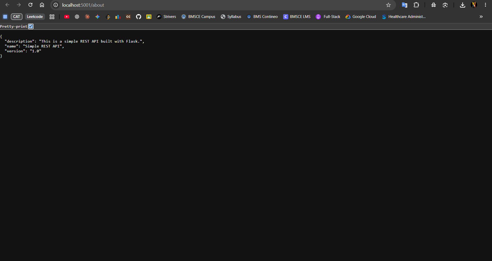

# Exercise: Docker Networking with Multiple Containers

## Problem Statement

Configure a Docker bridge network for a multi-container application consisting of:
- A Python Flask REST API
- A MySQL database container
- A Redis cache container

Connect all containers to the same custom bridge network, verify that they can resolve and communicate with one another by container name, and expose the Flask API to the host machine.

**Environment:** Windows, VS Code integrated terminal / Command Prompt, Docker Desktop

---

## Solution (Brief)

1. Create a custom bridge network named `my-bridge-net`.
2. Verify and inspect the network.
3. Create a Flask API and its Docker image.
4. Run MySQL, Redis, and Flask containers on the same bridge network.
5. Test the Flask API in a browser at `http://localhost:5001/about`.
6. Verify container-to-container name resolution.
7. Stop and remove the containers and network when finished.

---

## Step 1: Create a Docker Bridge Network

Run:

```bash
docker network create --driver bridge my-bridge-net
```

Verify the network:

```bash
docker network ls
```

You should see `my-bridge-net` with the `bridge` driver.

Inspect its configuration:

```bash
docker network inspect my-bridge-net
```

Docker will show details such as the network ID, subnet, gateway, and connected containers. The exact IDs and IP addresses can differ on your machine.

---

## Step 2: Create the Flask Application

Create a project folder, for example `docker-networking`, and open it in VS Code. Inside it, create the following files.

### `app.py`

```python
from flask import Flask, jsonify

app = Flask(__name__)

@app.route('/about', methods=['GET'])
def about():
    return jsonify({
        "name": "Simple REST API",
        "version": "1.0",
        "description": "This is a simple REST API built with Flask."
    })

if __name__ == '__main__':
    app.run(host='0.0.0.0', port=5001)
```

**Important:** `host='0.0.0.0'` allows Flask to accept connections arriving through the container's network interface. Without it, the API may only listen on the container's loopback interface.

### `requirements.txt`

```text
Flask==2.0.1
Werkzeug<3
```

The Werkzeug constraint avoids a compatibility issue that can occur when using Flask 2.0.1 with newer Werkzeug releases.

### `Dockerfile`

```dockerfile
FROM python:3.9-slim

WORKDIR /app

COPY requirements.txt .
RUN pip install --no-cache-dir -r requirements.txt

COPY app.py .

EXPOSE 5001

CMD ["python", "app.py"]
```

---

## Step 3: Build the Flask Image

Run these commands from the directory containing `Dockerfile`, `app.py`, and `requirements.txt`:

```bash
docker build -t flask-api .
```

Check that the image exists:

```bash
docker images
```

---

## Step 4: Launch the Containers

Start MySQL and Redis on the custom bridge network:

```bash
docker run -d --name mysql --network my-bridge-net -e MYSQL_ROOT_PASSWORD=ChangeMe123! mysql:8
```

```bash
docker run -d --name redis --network my-bridge-net redis:latest
```

Start Flask and publish its port to the host:

```bash
docker run -d --name flask --network my-bridge-net -p 5001:5001 flask-api
```

The MySQL password above is a lab example. For a real application, use a secure secret rather than putting credentials directly in a command.

Verify that all three containers are running:

```bash
docker ps
```

Check logs if a container does not start:

```bash
docker logs mysql
docker logs redis
docker logs flask
```

**Note:** This exercise connects the MySQL and Redis containers to the network; the Flask sample API does not yet query either service.

---

## Step 5: Test the Flask API

Open this URL in your browser:

```text
http://localhost:5001/about
```

The endpoint should return JSON similar to:

```json
{
  "description": "This is a simple REST API built with Flask.",
  "name": "Simple REST API",
  "version": "1.0"
}
```

You can also test from a terminal:

```bash
curl http://localhost:5001/about
```

### Output / Proof

The screenshot below shows the Flask API responding successfully at `localhost:5001/about`.



> Keep `docker-networking-output.png` in the same folder as this Markdown file. If your screenshot has a different filename, update the image path above.

---

## Step 6: Test Container-to-Container Connectivity

On a user-defined bridge network, Docker provides DNS resolution by container name. Test this from the Flask container.

Open a shell:

```bash
docker exec -it flask sh
```

The minimal Flask image may not include `ping`. You can still test DNS resolution with Python:

```bash
python -c "import socket; print('mysql:', socket.gethostbyname('mysql')); print('redis:', socket.gethostbyname('redis'))"
```

If the names resolve, Docker's internal DNS can find the containers. This confirms name resolution, not necessarily that the database or cache is ready to accept connections.

Exit the container shell:

```bash
exit
```

Optional: check that MySQL and Redis are running:

```bash
docker exec mysql mysqladmin ping -pChangeMe123!
docker exec redis redis-cli ping
```

The MySQL command may prompt for or require the password supplied when the container was created. Redis should typically respond with `PONG`.

---

## Step 7: Clean Up

Stop and remove the containers:

```bash
docker stop mysql redis flask
docker rm mysql redis flask
```

Remove the custom network:

```bash
docker network rm my-bridge-net
```

Only remove the network after its containers have been disconnected or removed.

---

## Key Observations and Learnings

- **Bridge network:** A user-defined bridge lets containers communicate on an isolated Docker network.
- **Container-name DNS:** Containers on the same user-defined bridge can usually reach each other using names such as `mysql` and `redis`.
- **Port publishing:** `-p 5001:5001` maps port 5001 on the host to port 5001 in the Flask container.
- **Internal versus external access:** Flask can reach other containers over the Docker network without publishing the database or cache ports to the host.
- **Network inspection:** `docker network inspect my-bridge-net` shows the network configuration and connected containers.

---

## Questions and Answers

### Q1. What is the purpose of the `--net` flag in `docker run`?

**Answer:** The `--net` flag specifies the Docker network to which a container should connect. This allows containers on the same network to communicate with each other.

### Q2. How do containers communicate with each other on the same network?

**Answer:** Containers communicate using their container names or IP addresses. On a user-defined bridge network, Docker provides DNS resolution, allowing containers to find each other by name.

### Q3. What is the difference between a bridge network and a host network?

**Answer:** A bridge network provides network isolation for containers, while a host network shares the host's network stack.

- **Bridge Network:** Containers are in a private room, communicating with each other through a door.
- **Host Network:** Containers share the host's network environment and communicate directly through the host's network stack.

### Q4. How can you expose a container's port to the host machine?

**Answer:** Use the `-p` flag with the `docker run` command to map a host port to a container port. For example:

```bash
docker run -d --name flask --network my-bridge-net -p 5001:5001 flask-api

## Result

A custom Docker bridge network was created, and the Flask API, MySQL, and Redis containers were configured to use it. The Flask API was published on host port 5001 and verified in the browser at `http://localhost:5001/about`. Container-name resolution was checked from within the Flask container.
