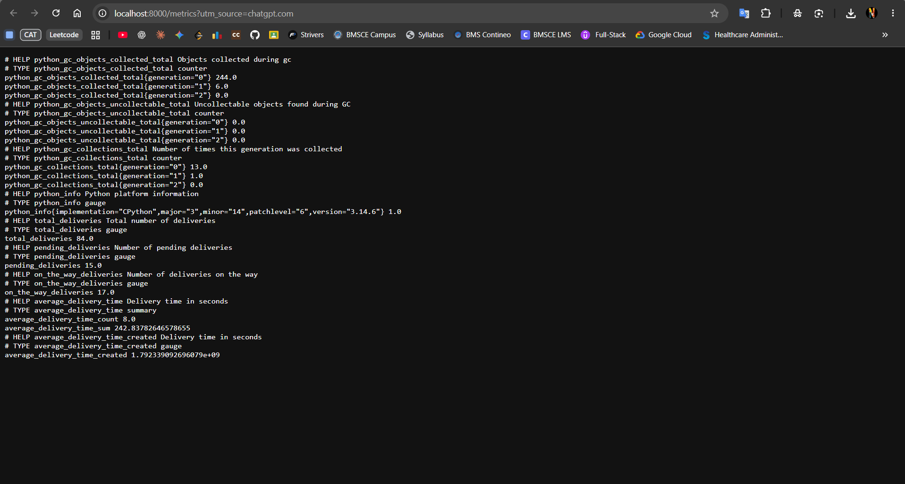
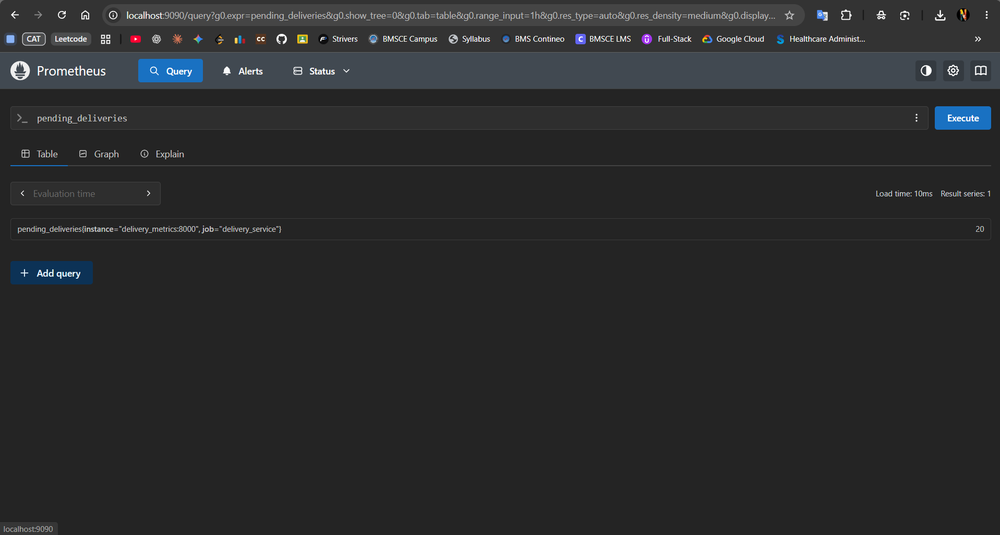
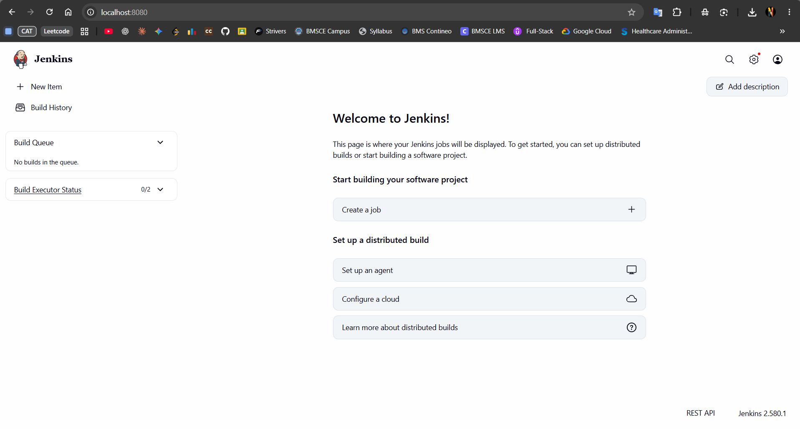

# Real-Time Operations Monitoring and Alerting — Solution

## 1. Project Overview

This project demonstrates real-time monitoring and alerting for a delivery operations service using **Python, Prometheus, Grafana, Docker, and Jenkins**.

The Python service exposes delivery metrics. Prometheus scrapes those metrics and lets you query them. Grafana can visualize the metrics in dashboards, while alert rules can identify conditions that need attention. Jenkins is available at `http://localhost:8080` for CI/CD setup.

## 2. Screenshots and Verification

### 2.1 Jenkins Dashboard

Jenkins is running and its home page is accessible at `http://localhost:8080`. The dashboard is ready for creating a job or configuring a pipeline.

### 2.2 Python Metrics Endpoint

The Python service exposes its Prometheus metrics at `http://localhost:8000/metrics`. The output includes the custom delivery metrics:
- `total_deliveries`
- `pending_deliveries`
- `on_the_way_deliveries`
- `average_delivery_time`

The screenshot shows the endpoint returning metric data successfully.

### 2.3 Prometheus Query

Prometheus is accessible at `http://localhost:9090`. The query `pending_deliveries` returns a value for the `delivery_service` target, confirming that Prometheus has scraped the custom metric.

## 3. Metrics Observed

The metrics endpoint screenshot shows these values at the time it was captured:

| Metric | Observed value |
|---|---:|
| `total_deliveries` | 84 |
| `pending_deliveries` | 15 |
| `on_the_way_deliveries` | 17 |
| `average_delivery_time_count` | 8 |
| `average_delivery_time_sum` | 242.83782646578655 |

The Prometheus query screenshot displays `pending_deliveries` as **20** at its evaluation time. These values may differ because the screenshots were captured at different times or the service's values changed between captures.

## 4. Implementation Summary

1. **Python exporter:** Defines and exposes delivery metrics on port `8000`.
2. **Prometheus:** Scrapes the Python exporter and makes metrics queryable on port `9090`.
3. **Grafana:** Can use Prometheus as a data source to build operational dashboards on port `3000`.
4. **Jenkins:** Runs on port `8080` and can be configured to build, test, and deploy the application.

## 5. Verification Steps

1. Open `http://localhost:8080` and confirm the Jenkins dashboard loads.
2. Open `http://localhost:8000/metrics` and confirm the delivery metrics are displayed.
3. Open `http://localhost:9090`, query `pending_deliveries`, and click **Execute**.
4. To check the Prometheus target, open **Status → Targets** and verify that the `delivery_metrics` target is **UP**.
5. If Grafana has been configured, open `http://localhost:3000`, set the Prometheus data source URL to `http://prometheus:9090` when Grafana runs in the same Docker Compose network, and create panels using the metrics above.

## 6. Result

The screenshots demonstrate that Jenkins is accessible, the Python application exposes delivery metrics, and Prometheus can query the `pending_deliveries` metric. Grafana dashboards and Jenkins pipelines can be configured as the next steps if they have not already been completed.

---

*Note: Keep the three screenshot files in the same directory as this Markdown file for the embedded images to render.*
