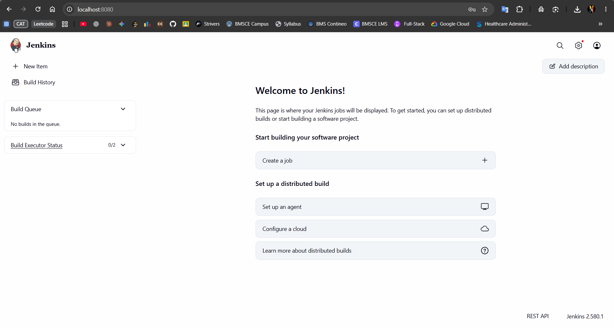

# Introduction to Continuous Integration (CI) and Jenkins Installation

## 1. Introduction to Continuous Integration (CI)

Continuous Integration (CI) is a software development practice in which developers frequently integrate code changes into a shared repository. Automated builds and tests help detect errors early, improve software quality, and provide faster feedback.

### Key Features of CI

1. **Frequent code integration:** Developers regularly commit changes to a shared repository.
2. **Automated builds:** Code changes trigger build steps to verify that the project can be built.
3. **Automated testing:** Tests check that changes have not broken existing functionality.
4. **Immediate feedback:** Build and test results help developers identify and fix problems promptly.

### Benefits of CI

- **Early bug detection:** Integration problems can be found sooner.
- **Improved collaboration:** Changes are integrated into a shared codebase more consistently.
- **Faster development cycles:** Automation reduces repetitive manual work.
- **Higher code quality:** Automated tests help identify regressions.

### How CI Works

1. A developer changes code and pushes it to a version-control repository such as Git.
2. A CI server detects the change or runs a configured job.
3. The server checks out the code and performs build steps.
4. Automated tests run to check functionality.
5. The server reports success or failure so the team can respond.

## 2. Examples of CI/CD Tools

| Tool | Overview / key features | Suitable for |
|---|---|---|
| GitLab CI/CD | Integrated with GitLab; YAML-based pipeline configuration; Auto DevOps | Teams using GitLab |
| CircleCI | Cloud-based CI/CD; container-based jobs; parallelism and caching | Containerized workflows |
| Travis CI | CI service with YAML configuration and repository integration | Open-source projects and small teams |
| Bamboo | Atlassian CI/CD tool with build and deployment plans | Teams using Atlassian tools |
| TeamCity | CI server with build history, reports, runners, and plugins | Complex development environments |
| Azure DevOps Pipelines | CI/CD integrated with Azure and Visual Studio; YAML or visual configuration | Teams using Azure DevOps |
| GitHub Actions | Repository-integrated workflows and a marketplace of actions | Teams using GitHub |
| Spinnaker | Continuous delivery for cloud-native applications and multi-cloud deployments | Cloud-based delivery workflows |
| Buildkite | Cloud-managed pipelines that can run on self-hosted agents | Teams requiring control over build infrastructure |
| Drone | Container-based pipeline execution and repository integrations | Container-focused workflows |

## 3. Introduction to Jenkins

Jenkins is an open-source automation server used to automate tasks involved in building, testing, and deploying software. It supports Continuous Integration (CI) and Continuous Delivery (CD).

### Why Use Jenkins?

- **Automation:** Automates repetitive development tasks.
- **Continuous Integration:** Helps validate code changes.
- **Extensibility:** Plugins provide integrations with many development tools.
- **Scalability:** Build work can be distributed across agents.

### Key Jenkins Concepts

1. **Job/Project:** A task or process configured to run in Jenkins.
2. **Build:** An execution of a job or pipeline.
3. **Pipeline:** A sequence of steps used to build, test, and potentially deploy software.
4. **Plugins:** Extensions that add features or integrations.
5. **Nodes:** Machines that execute Jenkins work; a controller can delegate work to agents.

## 4. Install Jenkins Using Docker

The exercise uses Docker to run Jenkins.

Run the following command in a terminal where Docker is available:

```bash
docker run -d --name jenkins -p 8080:8080 -p 50000:50000 jenkins/jenkins:lts
```

- `-d` runs the container in the background.
- `--name jenkins` assigns the container the name `jenkins`.
- `-p 8080:8080` exposes the Jenkins web interface on port `8080`.
- `-p 50000:50000` publishes the port commonly used for inbound agent connections.
- `jenkins/jenkins:lts` selects the Jenkins Long-Term Support image.

If Docker reports that a container named `jenkins` already exists, check it with `docker ps -a`. Start the existing container with `docker start jenkins` rather than creating a duplicate.

### Example Installation Output

The Docker command may download the Jenkins image if it is not already present. After the image is downloaded, Docker creates and starts the container and prints its container ID.

## 5. Verify the Jenkins Container

Run:

```bash
docker ps -a
```

Confirm that the `jenkins` container is listed and that its status is `Up`. The port mapping should include `8080` mapped to container port `8080`.

## 6. Retrieve the Initial Administrator Password

Run:

```bash
docker exec jenkins cat /var/jenkins_home/secrets/initialAdminPassword
```

Copy the displayed password and use it only on the Jenkins unlock page. Keep it private and do not include the password in submitted screenshots or reports.

If the command fails, confirm the container is running with `docker ps -a`. If it is stopped, run `docker start jenkins` and retry.

## 7. Access Jenkins and Complete Setup

Open the Jenkins interface in a browser:

**URL:** http://localhost:8080

1. Enter the initial administrator password if the Unlock Jenkins page appears.
2. Select **Install suggested plugins**.
3. Create an administrator account when prompted.
4. Continue through the setup prompts until the Jenkins dashboard appears.

The Jenkins dashboard confirms that the web interface is accessible and initial setup has reached the home page.


## 8. Jenkins Dashboard Screenshot

The screenshot below shows the Jenkins dashboard loaded at `http://localhost:8080`, confirming that Jenkins is accessible after installation and setup.



## 9. Result

Jenkins has been installed and launched using Docker, the initial administrator password can be retrieved from the container, and the web interface is accessible at `http://localhost:8080`.

This solution covers the introduction to CI, common CI/CD tools, Jenkins concepts, and the installation and initial setup tasks. It does not include creating or running a Jenkins pipeline, because those tasks are not explicitly required in the supplied exercise.
