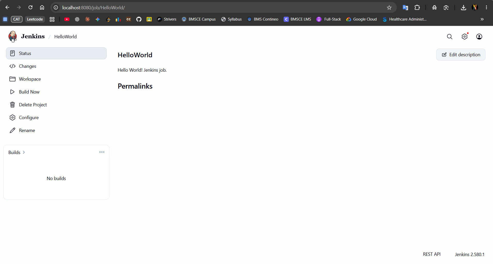
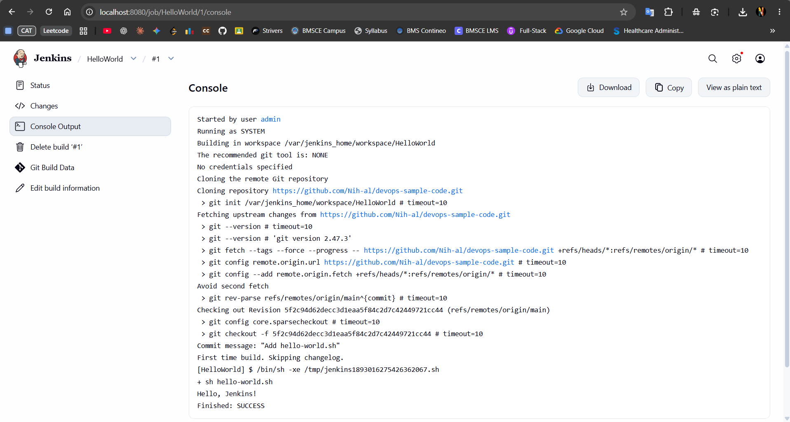

# Jenkins HelloWorld Job — Solution

## Objective
Configure a Jenkins Freestyle job to retrieve a shell script from GitHub, execute it, and verify the build output.

## 1. Create the GitHub repository and script
Create a GitHub repository and add a file named `hello-world.sh`:

```bash
#!/bin/bash
echo "Hello, Jenkins!"
```

Commit and push the file to the `main` branch. Confirm that the repository URL and branch are correct before configuring Jenkins.

## 2. Configure the Jenkins job
1. Open Jenkins at `http://localhost:8080`.
2. Open the **HelloWorld** job and select **Configure**.
3. Under **Source Code Management**, select **Git**.
4. Set **Repository URL** to the GitHub repository containing `hello-world.sh`, for example:

   `https://github.com/Nih-al/devops-sample-code.git`

5. Set **Branches to build** to `*/main`.
6. For a public repository, credentials can usually remain **- none -**. For a private repository, configure suitable GitHub credentials.
7. Under **Build Steps**, choose **Add build step → Execute shell**.
8. Enter:

   ```bash
   sh hello-world.sh
   ```

9. Click **Save**.

> If Git is missing from the Source Code Management options, install the Jenkins **Git** plugin (and its required dependencies) through **Manage Jenkins → Plugins**, then return to job configuration.

## 3. Run the job
1. Open the **HelloWorld** job.
2. Click **Build Now**.
3. Open the build number, then choose **Console Output**.

## 4. Verification screenshots

### Screenshot 1 — HelloWorld job page


The job page shows the configured `HelloWorld` job and the build navigation.

### Screenshot 2 — Console Output


The console output shows Jenkins cloning the GitHub repository, checking out the `main` branch, running `hello-world.sh`, and printing:

```text
Hello, Jenkins!
Finished: SUCCESS
```

This confirms that the job successfully retrieved the script and executed it.

## Result
The Jenkins Freestyle job was configured to pull the shell script from GitHub and run it. The console output confirms a successful build.

## Troubleshooting notes
- **Only “None” appears under Source Code Management:** Check that the Jenkins Git plugin is installed and enabled.
- **Repository access fails:** Verify the repository URL and ensure Jenkins has credentials if the repository is private.
- **Push rejected because remote has newer commits:** Run `git pull --rebase origin main`, resolve any conflicts if prompted, then run `git push -u origin main`.
- **Build cannot find the script:** Confirm `hello-world.sh` is committed at the repository root on the branch Jenkins checks out, or update the shell command to its relative path.
